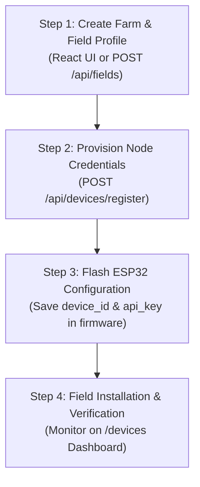

# 📱 AgriN Device Registration Guide
**System:** AgriSense IoT Edge Device Onboarding  
**Document Code:** AGRIN-REG-GUIDE-001  

---

## 1. Onboarding Workflow

Deploying a new AgriSense IoT node involves four simple steps:



---

## 2. Step-by-Step Instructions

### Step 1: Farm & Field Preparation
1. Open the AgriN Web Client at `http://localhost:5173`.
2. Go to **Farm Details** (`/farm-details`) to record the district, state, and GPS coordinates of your farm.
3. If using the API directly, create an agricultural plot using:
   ```bash
   curl -X POST "http://localhost:8000/api/fields" \
        -H "Content-Type: application/json" \
        -d '{"farm_id": "farm-01", "name": "Plot A", "soil_type": "black"}'
   ```

### Step 2: Register Hardware Node
Navigate to `/devices/register` in the frontend or issue an API registration call:
```bash
curl -X POST "http://localhost:8000/api/devices/register" \
     -H "Content-Type: application/json" \
     -d '{
       "farm_id": "farm-01",
       "field_id": "field-plot-a",
       "name": "AgriSense-Plot-A-Probe",
       "hardware_profile": "ESP32-DevKit-V1-Standard"
     }'
```
> [!IMPORTANT]
> The response will contain `device_id` and `api_key`. **Copy and store the `api_key` immediately**; for security, only its cryptographic hash is stored in the database.

### Step 3: Flash Firmware Profile
Open `firmware/hardware_profile.json` and insert your server address and credentials:
```json
{
  "board": "ESP32-DevKit-V1",
  "backend": {
    "device_id": "YOUR_DEVICE_ID_HERE",
    "api_key": "YOUR_API_KEY_HERE",
    "api_base_url": "http://YOUR_SERVER_IP:8000",
    "telemetry_endpoint": "/api/telemetry/ingest"
  }
}
```

### Step 4: Verification via Simulator (Before Field Deployment)
Before physically burying probes in soil, verify network communication using the simulator:
```powershell
python scripts/simulate_device.py --device-id "YOUR_DEVICE_ID_HERE" --scenario optimal_field --once
```
Check `http://localhost:5173/devices` to verify live telemetry visualization.
