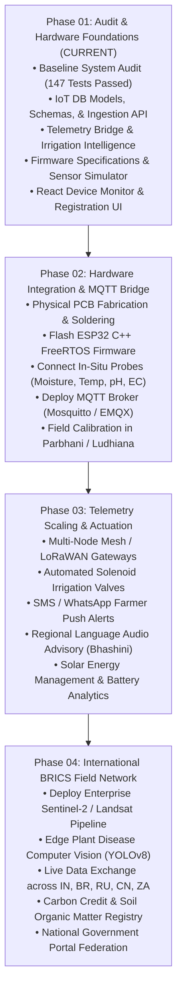

# 🗺️ AgriN Phased Development Roadmap
**Strategic Roadmap:** From In-Silico Intelligence to Pan-India Field Deployment  
**Document Code:** AGRIN-ROADMAP-001  

---

## 📅 Four-Phase Evolution

---

## Phase Milestones & Deliverables

### Phase 01: Baseline Audit & Hardware Foundations (Completed)
- Complete system audit & zero fabrication verification.
- Implemented IoT relational tables, Pydantic schemas, and `/api/telemetry/ingest`.
- Implemented `telemetry_to_intelligence.py` bridge and `irrigation_intelligence.py`.
- Developed `simulate_device.py` software-only hardware simulator.
- Implemented React `DeviceMonitor.jsx` and `DeviceRegistration.jsx`.
- Verified 147 unit/integration tests passing (100%) and 18 regional validation scenarios.

### Phase 02: Physical Hardware Assembly & MQTT Bridge
- PCB milling and component assembly for ESP32 DevKit V1, ADS1115, and MAX3485.
- Connect physical probes and perform laboratory 2-point buffer calibration.
- Flash C++ ESP-IDF / Arduino firmware with light-sleep power management.
- Establish MQTT telemetry ingestion with offline flash buffer synchronization.
- Initial field test in experimental agricultural plot.

### Phase 03: Farmer Telemetry Scaling & Multilingual Access
- Scaled multi-node monitoring across multiple farms and fields.
- Integration of irrigation relay actuators for automated valve scheduling.
- Low-bandwidth SMS and WhatsApp advisory notifications.
- Multilingual voice synthesis (Hindi, Marathi, Punjabi, Tamil, Telugu).

### Phase 04: Global Cooperation & Enterprise Remote Sensing
- Provisioning of Copernicus Sentinel-2 Level-2A multi-spectral pipeline.
- High-resolution NDVI, NDRE, NDWI vegetative indices fusion.
- Deployment of edge computer vision model for real-time crop disease screening.
- Full interoperability testing with BRICS national agricultural data hubs.
