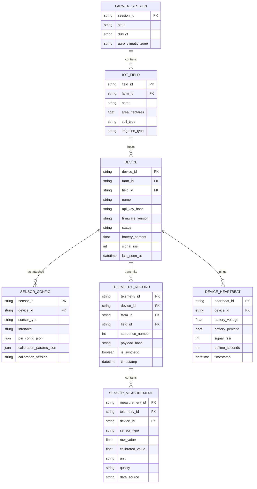

# 🏛️ AgriN Target System Architecture
**System:** AgriN — Regenerative Agricultural Intelligence Network powered by AgriSense IoT  
**Target Revision:** Phase 01 Hardware-Ready Architecture  
**Document Code:** AGRIN-ARCH-001  

---

## 1. System Overview Architecture

AgriN integrates low-power edge sensing, cloud-based data normalization, multi-layer biophysical reasoning, machine learning ensembles, and farmer-facing visual telemetry.

```mermaid
flowchart LR
    subgraph Hardware["1. Edge Hardware Layer (AgriSense IoT)"]
        ESP32["ESP32 DevKit V1\n(Dual Core 240MHz)"]
        ADS["ADS1115 16-bit ADC\n(I2C: 0x48)"]
        RS485["MAX3485 Modbus\n(UART @ 9600 baud)"]
        
        MOIST["Capacitive Soil Moisture\n(Analog → ADS1115 A0)"]
        TEMP["DS18B20 Temp Probe\n(OneWire 3.3V)"]
        PH["Soil pH Probe + Board\n(Analog → ADS1115 A1)"]
        EC["Soil EC Probe + Board\n(Analog → ADS1115 A2)"]
        NPK["RS485 NPK Sensor\n(Modbus RTU)"]
        PWR["Solar (5W) + Li-ion (3.7V)\nCN3065 Charger + Boost"]
        
        MOIST --> ADS
        PH --> ADS
        EC --> ADS
        NPK --> RS485
        ADS --> ESP32
        TEMP --> ESP32
        RS485 --> ESP32
        PWR -.-> ESP32
    end

    subgraph Firmware["2. Embedded Firmware Layer"]
        SM["Firmware State Machine\n(Boot → Sample → JSON)"]
        CALIB["Calibration Engine\n(Dry/Wet, pH 4/7)"]
        WIFI["Wi-Fi / TLS Client\n(HTTPS Ingest)"]
        OFFBUF["SPI Flash RingBuffer\n(Offline Telemetry)"]
        
        ESP32 --> SM
        SM --> CALIB
        CALIB --> WIFI
        WIFI -.->|Offline| OFFBUF
    end

    subgraph Backend["3. Ingestion & Core Backend (FastAPI)"]
        API["REST API Gateway\n(/api/telemetry/ingest)"]
        AUTH["Device Auth & HMAC\n(API Key Verification)"]
        VAL["Pydantic Strict Validation\n(Range & Schema Checks)"]
        DEDUP["Deduplication Engine\n(SHA-256 Payload Hash)"]
        
        WIFI -->|HTTPS POST| API
        API --> AUTH
        AUTH --> VAL
        VAL --> DEDUP
    end

    subgraph Database["4. Persistence Layer (SQLite / PostgreSQL)"]
        DB_DEV[("devices")]
        DB_TEL[("telemetry_records")]
        DB_MEAS[("sensor_measurements")]
        DB_FLD[("iot_fields")]
        DB_HB[("device_heartbeats")]
        
        DEDUP --> DB_TEL
        DEDUP --> DB_MEAS
        DEDUP --> DB_DEV
    end

    subgraph Intelligence["5. Biophysical & ML Intelligence Engines"]
        BRIDGE["Telemetry-to-Intelligence Bridge\n(Provenance Enforcement)"]
        ACZ["ICAR Agro-Climatic Engine\n(15 Macro-Zones)"]
        WX["Open-Meteo NWP Telemetry\n(Live Weather)"]
        IRR["Irrigation Intelligence\n(FAO-56 MAD Depletion)"]
        SUIT["Hybrid Crop Suitability\n(Random Forest + Rule Gates)"]
        REGEN["Regenerative Practice Engine\n(Soil Restoration Plan)"]
        RESIL["Farm Resilience Index\n(0-100 Gauge)"]
        
        DEDUP --> BRIDGE
        BRIDGE --> ACZ
        BRIDGE --> WX
        BRIDGE --> IRR
        BRIDGE --> SUIT
        SUIT --> REGEN
        REGEN --> RESIL
    end

    subgraph Frontend["6. React 19 Farmer Dashboard"]
        UI_MON["Device Monitor (/devices)\n(Live Telemetry & Gauges)"]
        UI_REG["Device Registration (/devices/register)"]
        UI_REC["Crop Recommendations (/recommendations)"]
        UI_SIM["What-If Simulator (/what-if)"]
        
        DB_MEAS -.-> UI_MON
        RESIL -.-> UI_MON
        IRR -.-> UI_MON
        SUIT -.-> UI_REC
    end
```

---

## 2. Multi-Device, Multi-Farm, Multi-Field Hierarchy

The platform supports scalable multi-tenancy:

---

## 3. Strict Data Provenance Flow

AgriN implements strict provenance typing. Data sources are categorized into non-interchangeable tiers:

| Provenance Class | Definition | Allowed Operations | Visual Badge |
| :--- | :--- | :--- | :---: |
| **`SENSOR_MEASURED`** | Direct physical measurement from hardware sensor | Used in irrigation calculation, soil health scoring | 🟢 **LIVE SENSOR** |
| **`CALCULATED`** | Mathematically derived from verified physical measurements | Evapotranspiration ($ET_0$), water depletion percentage | 🟡 **CALCULATED** |
| **`EXTERNAL_OBSERVED`** | Ingested via external API (e.g. Open-Meteo NWP forecasts) | Weather inputs, rainfall normals | 🔵 **EXTERNAL** |
| **`ML_ESTIMATED`** | Inferred from machine learning predictive models | Crop suitability probability, feature importance | 🟡 **ESTIMATED** |
| **`LABORATORY_REPORTED`**| Certified lab assay (Soil Health Card) | Soil chemistry baseline, micronutrient profiling | 🟢 **LAB REPORT** |
| **`FARMER_ENTERED`** | User-inputted survey response (UI wizard) | Crop selection, boundary geometry, irrigation type | ⚪ **USER ENTERED** |
| **`SYNTHETIC`** | Simulated development data (`simulate_device.py`) | Development, staging, automated tests | 🟣 **SYNTHETIC** |
| **`UNAVAILABLE`** | Missing or disconnected sensor | Surfaced as explicit empty state; **NEVER** fabricated | 🔴 **UNAVAILABLE** |
